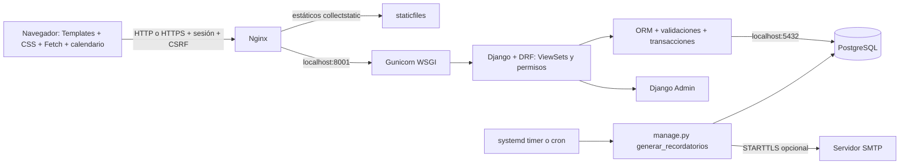

# Arquitectura y decisiones

## Componentes

En desarrollo `runserver` reemplaza Nginx/Gunicorn. `DEBUG=False` por defecto; `.env` generado en desarrollo activa DEBUG explícitamente. No hay clave por defecto en código. PostgreSQL es el único backend de `DATABASES`.

## Capas y responsabilidades

- `models.py`: entidades, claves foráneas y restricciones; `full_clean()` en escrituras ordinarias, dentro de transacciones para citas y disponibilidades.
- `serializers.py`: contrato REST, normalización RUT, validación de usuarios y protección de campos automáticos.
- `api.py`: ViewSets/routers, filtros y búsquedas, paginación, controles de autoría y auditoría de las operaciones.
- `permissions.py`: reglas por grupo Django y permisos de objeto. Veterinario necesita cuenta y perfil activos.
- `services.py`: reconciliación de recordatorios y envío SMTP.
- `signals.py`: generación de avisos al guardar vacunas y creación de grupos después de migrar.
- `views.py`: login, acceso al panel e historial imprimible protegido.
- `admin.py`: configuración administrativa. Los inlines útiles son mascotas en tutor, horarios en veterinario y perfil veterinario en usuario.
- `static/app.js`: Fetch con cookies/CSRF, vistas y formularios. No almacena datos clínicos en localStorage.

## Concurrencia de reservas

1. Cada alta/modificación de cita abre `transaction.atomic()`.
2. Al editar se bloquea la cita existente con `select_for_update()`.
3. Se bloquean los profesionales afectados en orden de PK, y después las mascotas en orden de PK. Estas filas existen incluso cuando no hay citas previas, evitando el problema de bloquear una consulta vacía.
4. Dentro del bloqueo se vuelve a validar profesional activo, duración y disponibilidad; se consultan conflictos por profesional **o** mascota con `inicio < fin_otro` y `fin > inicio_otro`.
5. La escritura y el commit se realizan dentro de la misma transacción.
6. PostgreSQL añade dos `ExclusionConstraint` GiST mediante `btree_gist`: igualdad de profesional/mascota y solapamiento del `tsrange(fecha+inicio, fecha+término, '[)')`. Canceladas quedan fuera. Esto también protege escrituras que omitan las validaciones del modelo.

`[)` permite citas adyacentes. Completadas conservan la ocupación histórica. Las modificaciones de disponibilidad bloquean el profesional y comprueban que ninguna cita futura pendiente/confirmada quede sin cobertura. La disponibilidad no es solo una validación visual.

Estas reglas están codificadas y tienen pruebas concurrentes con conexiones reales; su ejecución quedó pendiente por la restricción de sockets del entorno. Una transacción estándar con `SELECT FOR UPDATE` y exclusiones no necesita sustituir PostgreSQL ni elevar globalmente el aislamiento a SERIALIZABLE.

## Integridad, permisos e historial

RUT canónico y único, peso positivo, horas y fechas ordenadas, estados definidos, aplicación única por mascota/nombre/fecha y una ficha por cita opcional. `PROTECT` impide borrar tutores/pacientes/profesionales con historia. No se permite cambiar paciente/profesional de una cita que ya tiene ficha ni cancelarla como si no hubiera ocurrido.

Los roles aplican en servidor, además de la interfaz. Veterinarios consultan el historial compartido pero solo editan registros de su autoría; recepción no obtiene fichas ni impresión. El Admin requiere rol Administrador o Veterinario activo, `is_staff` y permisos Django; las escrituras clínicas también comprueban autoría. La auditoría registra actor, entidad, acción e ID; no duplica diagnósticos o recetas.

## Tiempo y recordatorios

Agenda en fecha/hora civil de la clínica (`America/Santiago`). No se convierten las horas de cita a UTC en el frontend. Eventos de auditoría/sesiones usan timestamps con zona de Django. Esto evita desplazar una cita por el huso del navegador. Franjas de atención no cruzan medianoche.

Un `OneToOne` vacuna-recordatorio y bloqueos durante reconciliación evitan duplicados. Los controles también tienen unicidad por mascota/tipo/fecha/huella MD5 del mensaje; la huella limita el tamaño del índice para mensajes largos. MD5 se usa solo como huella de deduplicación, nunca para contraseñas (PBKDF2). Cerrar seguimiento marca el aviso atendido; atender un aviso no equivale a aplicar una vacuna. Para nuevas aplicaciones se registra una nueva vacuna y se cierra el seguimiento anterior. Al cambiar la fecha de próxima dosis se actualiza/reabre el mismo aviso y se elimina la marca de correo enviado.

Envío: pendientes hasta 7 días, bloqueo `skip_locked`, timestamp de correo y error genérico sin datos sensibles. La semántica real es **al menos una vez** si SMTP acepta el mensaje y el proceso muere antes de confirmar la transacción. No se afirma entrega exactamente una vez.

## Migración del prototipo

Se inspeccionaron `server.py`, `schema.sql`, `static/index.html` y CSS. No existía una base de datos con registros que importar. Se conservaron servidor/esquema/HTML anteriores en `legacy/`, y se amplió la hoja de estilos. El esquema final es la migración Django, no el SQL anterior. No hay importación automática de bases SQLite antiguas: si aparecen, se necesita un proceso explícito de mapeo, validación de RUT/roles y revisión de datos.

## Portal de tutores y autenticación compartida

`forms.py` valida registro, cuenta y mascotas; `views.py` sirve un portal separado con historial de lectura y reservas guiadas. La relación nullable Tutor.usuario conserva registros anteriores. No se asignan historiales por correo ni se infiere un rol a partir de is_staff. Los querysets de API y las búsquedas del portal filtran por la cuenta antes de resolver objetos. Las reservas vuelven a comprobar propiedad después de bloquear al paciente para evitar cambios de dueño concurrentes.

`middleware.SecurityGate` protege el Admin y aplica contadores PostgreSQL por IP/cuenta en transacciones breves antes de autenticar. Los tokens de recuperación y sus vistas son nativos Django. Los grupos se crean idempotentemente después de migrar. Consultar `redisenio.md` para el alcance validado y `seguridad-operativa.md` para despliegue.
