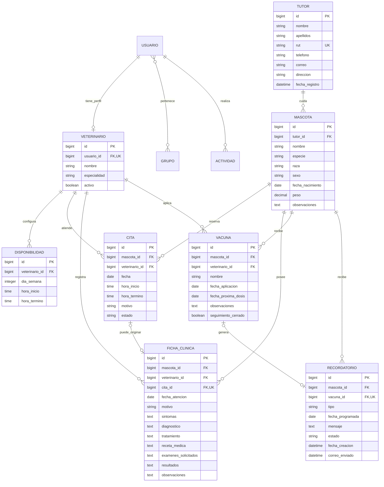
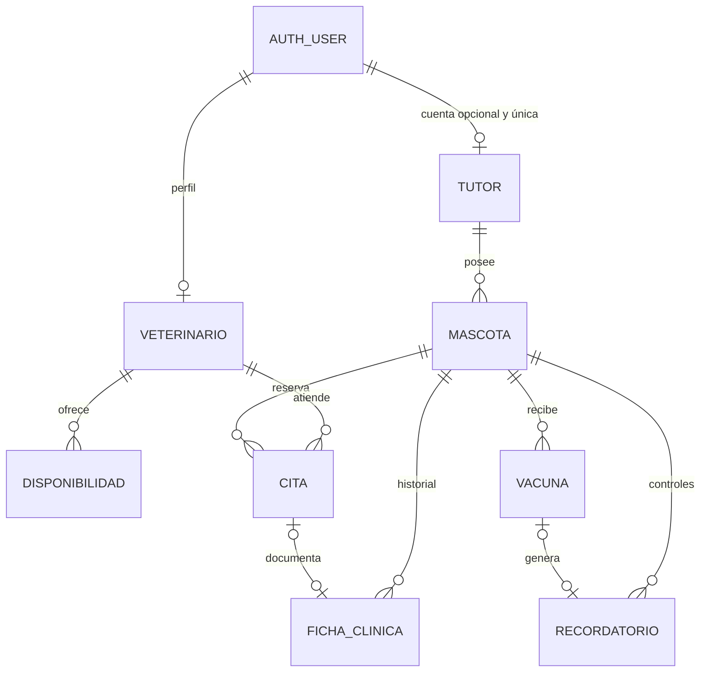

# Modelo entidad-relación

Usuarios, grupos, permisos y sesiones son tablas oficiales de Django; no se duplica el almacenamiento de contraseñas. FK crean índices ordinarios. Citas añade índices `(veterinario,fecha)` y `(mascota,fecha)`, índice por fecha y exclusiones GiST. Vacunas/recordatorios indexan próximas fechas. RUT es único; fecha de vacuna/nombre/mascota y recordatorio manual tienen restricciones de unicidad.

`Vacuna → Recordatorio` usa CASCADE para el aviso generado al eliminar una vacuna con autorización. Disponibilidades pertenecen al profesional y usan CASCADE. Datos clínicos hacia mascota/profesional/cita usan PROTECT. Actividad mantiene la acción si el usuario se elimina (`SET_NULL`). No se recomienda borrar usuarios: la interfaz administrativa permite desactivarlos.

## Extensión del portal (2026-11-05)

`Tutor.usuario` permite NULL para conservar tutores anteriores; una cuenta no puede vincularse a dos tutores. `LoginWindow` es una tabla operativa independiente con key hash única, contador y vencimiento; no almacena credenciales.
